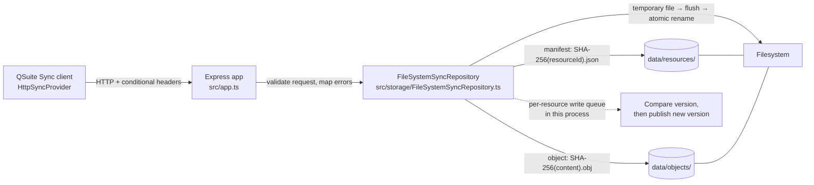

# QSuite SyncServer

Local Node.js/Express server for the `QSuite::Sync::ISyncProvider` contract.
This development server binds to `127.0.0.1` by default and has no
authentication; do not expose it to a shared network.

## Run

From this directory:

```bash
npm ci
npm test
npm run typecheck
npm run build
npm start
```

For development with automatic restart, use `npm run dev`. The default URL is
`http://127.0.0.1:3000`. Set `PORT`, `SYNC_SERVER_HOST`, or
`SYNC_SERVER_DATA_DIR` to configure the port, bind address, or persistent
storage directory. The default data directory is `./data`, resolved from the
current working directory.

## REST contract

- `GET /health` returns `{ "status": "ok" }`.
- `GET /v1/resources` returns an inventory of `{ resourceId, digest, version }`.
- `GET /v1/resources/:resourceId` returns a manifest envelope with its opaque
  `version`, base64 `content`, lowercase SHA-256 `digest`, and
  `objectDigests`. The version is also returned as a quoted `ETag`.
- `PUT /v1/resources/:resourceId` accepts the same fields except `version`.
  Send `If-None-Match: *` for create-only, or `If-Match: "<version>"` for a
  conditional update. A stale version returns HTTP 409 and does not replace
  the manifest.
- `HEAD /v1/objects/:digest` checks object presence;
  `GET /v1/objects/:digest` returns verified bytes; and
  `PUT /v1/objects/:digest` stores raw
  `application/octet-stream` bytes idempotently.

The server verifies manifest and object hashes and rejects manifests that
reference missing objects. JSON manifest requests are limited to 16 MB and
object uploads to 64 MB. Errors return a JSON `error` code and message.
Each completed API request is logged at info level with its method, route
template, HTTP status, and duration. Resource IDs, query strings, and request
bodies are not included in these request logs.

## Architecture and request flow



For a manifest update, the client first uploads any missing immutable objects,
then sends the manifest with `If-None-Match: *` for creation or
`If-Match: "<version>"` for an update. The app validates the request and
conditional header; the repository verifies manifest content and referenced
objects, serializes writes for that resource, compares the current version,
then atomically replaces the manifest with a new opaque version. A stale
version returns a conflict without replacing the manifest. Object writes are
idempotent because their digest is their storage key.

### Code map

- `src/index.ts` reads configuration and starts/stops the HTTP server.
- `src/app.ts` defines routes, checks request shapes and conditional headers,
  and translates repository errors into HTTP responses.
- `src/storage/FileSystemSyncRepository.ts` owns disk layout, integrity checks,
  concurrency checks, and atomic persistence.
- `src/errors.ts` defines the stable error codes shared by the app and storage
  layer.
- `test/sync-server.test.ts` exercises the HTTP contract and persistence
  behavior with temporary directories.

### Repository write path

`writeObject` validates the digest against the bytes and stores an object only
if it is not already present. `writeResource` validates the manifest, confirms
all referenced objects exist, then enters a per-resource write queue. Within
that queue it checks the expected version, assigns a new version token, and
uses `atomicWrite` to publish the new manifest. `atomicWrite` writes and flushes
a unique temporary file before renaming it into place, so a failed write does
not expose partial contents.

Resource IDs are never used directly as paths: `resourcePath` hashes them to
produce manifest filenames. Object digests are format-checked before being
used as object filenames. Reads re-check stored digests so filesystem
corruption is surfaced as an I/O error rather than returned as valid sync data.

## Storage and reliability

Manifests are stored under `resources/` using SHA-256 of the resource ID as the
filename. Immutable objects are stored under `objects/<sha256>.obj`. Each
write is first flushed to a unique temporary file and then atomically
renamed; manifest writes are serialized per resource within this single server
process. The server stores objects before publishing a manifest, so an
interrupted upload can leave harmless unreferenced objects but cannot publish a
manifest that references an unavailable object.

The disk store is authoritative and survives process restarts as long as the
same data directory is used. The implementation is intentionally single-node
and local-only; authentication, multi-process shared-store locking, backups,
object garbage collection, tombstones, and production deployment are outside
this initial scope.

## Tests

`npm test` exercises the HTTP app using temporary storage, including object
integrity, conditional-write conflicts, concurrent compare-and-write requests,
missing object references, and reading persisted bytes after recreating the
server app with the same data directory.

For the full client workflow, follow
[UIRichText local sync testing](../../../EndUser/UIRichText/LOCAL_SYNC.md).
